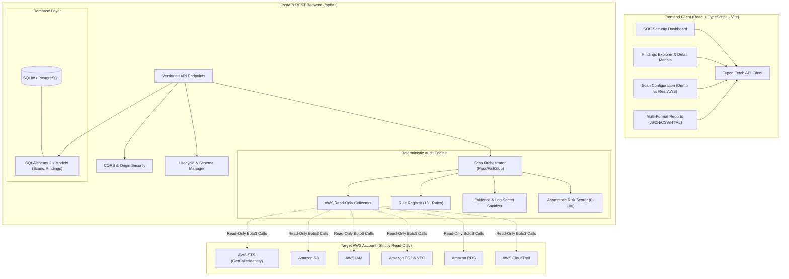

# CloudSentinel — AWS Cloud Security & Compliance Auditor

[](https://github.com/Shashank101-aiml/cloudsentinel-aws-security-auditor/actions)
[](https://opensource.org/licenses/MIT)
[](https://www.python.org/)
[](https://fastapi.tiangolo.com/)
[](https://react.dev/)
[](https://tailwindcss.com/)

> **Portfolio-Grade Cloud Security Auditing Platform**: Connects to AWS via read-only credentials or assumed IAM roles to discover resources, evaluate deterministic security rules, calculate actionable risk scores, and generate multi-format remediation reports.

---

## 1. Project Overview

**CloudSentinel** is a cloud security posture auditing application designed for Cloud Security Engineers, DevSecOps practitioners, and Solutions Architects. It conducts automated, deterministic security evaluations against AWS accounts to identify critical misconfigurations before attackers can exploit them.

### Operating Philosophy
1. **Read-Only by Default**: CloudSentinel strictly calls `Describe*`, `Get*`, and `List*` AWS APIs. It never modifies, deletes, or alters your AWS resources.
2. **Zero Credential Storage**: Raw credentials or secrets are never submitted via the browser, never saved in databases, and automatically scrubbed from logs.
3. **Evidence-Based Auditing**: Every finding provides sanitized JSON evidence from actual AWS inspection, concrete remediation guidance, and official AWS documentation references.
4. **Offline Demo Sandbox**: Works 100% out of the box with deterministic simulation data without needing an active AWS account.

---

## 2. Problem Statement

Modern cloud environments suffer from configuration drift and human error:
- S3 buckets unintentionally exposed to the public internet via conflicting policies or ACLs.
- Overly permissive IAM policies granting `Action: "*"` and `Resource: "*"`.
- Security groups with administrative ports (SSH 22, RDP 3389) open to `0.0.0.0/0`.
- Unencrypted storage volumes (EBS, RDS) risking data exfiltration.
- Missing or disabled CloudTrail logging impairing forensic visibility during incidents.

CloudSentinel provides a transparent, testable, open-source security scanner that quantifies security risk and delivers immediate remediation steps.

---

## 3. Key Features

- **Multi-Service Security Auditing**:
  - **Amazon S3**: Public ACLs, S3 Block Public Access flags, server-side encryption, versioning, secure transport enforcement.
  - **AWS IAM**: Full admin permissions, wildcard actions, risky trust policies, root account MFA status.
  - **Amazon EC2 & VPC**: Public SSH (port 22), public RDP (port 3389), open database ports, unencrypted EBS volumes, public IPv4 tracking.
  - **Amazon RDS**: Publicly accessible database instances, unencrypted storage, insufficient automated backup retention.
  - **AWS CloudTrail**: Missing trails, paused logging, single-region coverage limitations, disabled log file integrity validation.
- **Transparent Asymptotic Risk Scoring**: Normalizes risk into an intuitive **0 to 100 score** based on finding severity and affected resources.
- **Drift & Comparison Analysis**: Compare baseline and comparison scans to track new, persistent, and resolved findings over time.
- **Local Finding Review Workflow**: Mark findings as `OPEN`, `ACKNOWLEDGED`, `RESOLVED`, or `ACCEPTED_RISK` directly in the dashboard (modifies application records only).
- **Multi-Format Report Export**: One-click exports in sanitized **JSON**, formula-injection-safe **CSV**, and standalone **HTML**.
- **Interactive Security SOC Dashboard**: Built with modern dark-mode aesthetics, responsive filters, and real-time polling.

---

## 4. Architecture Diagram



---

## 5. Technology Stack

### Backend
- **Python 3.12+**
- **FastAPI**: Asynchronous REST API framework
- **Uvicorn**: High-performance ASGI server
- **Boto3 & Botocore**: Official AWS SDK with adaptive bounded retry configuration
- **SQLAlchemy 2.x**: SQL persistence with SQLite local storage and PostgreSQL support
- **Pydantic 2.x**: Strict data validation and settings management
- **Pytest**: Automated testing with 100% offline rule and API suites
- **Ruff & Bandit**: Fast linting and security vulnerability scanning

### Frontend
- **React 18 & TypeScript**
- **Vite**: Modern build tooling
- **Tailwind CSS**: Enterprise dark cybersecurity theme
- **Lucide Icons**: Intuitive iconography

### Infrastructure & DevOps
- **Docker & Docker Compose**: Multi-container containerization
- **GitHub Actions**: Continuous integration running tests, linting, and builds
- **Terraform**: Optional module for least-privilege IAM auditor role creation

---

## 6. Screenshots & Interface Preview

| Dashboard & Risk Score | Findings Explorer & Detail |
|:---:|:---:|
|  |  |

---

## 7. Local Setup Instructions

### Prerequisites
- Python 3.12+
- Node.js 20+ & npm
- Git

### 1. Clone & Configure
```bash
git clone https://github.com/Shashank101-aiml/cloudsentinel-aws-security-auditor.git
cd cloudsentinel-aws-security-auditor

# Setup environment file
cp .env.example .env
```

### 2. Backend Setup
```bash
# Create and activate virtual environment
python -m venv .venv
source .venv/bin/activate  # On Windows: .venv\Scripts\activate

# Install dependencies
pip install -r backend/requirements-dev.txt

# Start backend server
cd backend
uvicorn app.main:app --reload --host 0.0.0.0 --port 8000
```
Backend API will be live at: [http://localhost:8000](http://localhost:8000)
Swagger documentation: [http://localhost:8000/docs](http://localhost:8000/docs)

### 3. Frontend Setup
In a new terminal window:
```bash
cd frontend
npm install
npm run dev
```
Open your browser to: [http://localhost:5173](http://localhost:5173)

---

## 8. Docker Setup Instructions

Run the entire application in isolated containers with persistent storage:

```bash
docker-compose up --build
```
- Frontend UI: [http://localhost:5173](http://localhost:5173)
- Backend API: [http://localhost:8000](http://localhost:8000)

---

## 9. Demo Mode Instructions

No AWS account? No problem!
1. Start CloudSentinel via local commands or Docker.
2. The platform automatically seeds deterministic sample data showing:
   - S3 public bucket and missing default encryption
   - EC2 security group exposing SSH (port 22) publicly
   - IAM policy granting `Action: "*"` and `Resource: "*"`
   - Unencrypted EBS storage volume
   - Publicly accessible RDS PostgreSQL database
   - Paused CloudTrail logging
3. Explore the dashboard, filter findings, update review statuses, and download reports.
4. Click **"Reset Demo Baseline"** anytime to reset demo records to their initial state.

---

## 10. AWS Authentication Options

When you are ready to audit a real AWS account:

1. **Option A: Local AWS CLI Profile (Recommended)**:
   Ensure your AWS CLI profile is configured:
   ```bash
   aws configure --profile security-auditor
   ```
   Select this profile in the CloudSentinel scan dialog.

2. **Option B: Environment Variables**:
   Set `AWS_ACCESS_KEY_ID`, `AWS_SECRET_ACCESS_KEY`, and optional `AWS_SESSION_TOKEN` in your backend shell.

3. **Option C: Assumed IAM Role**:
   Provide an IAM Role ARN in the scan configuration dialog or `.env`.

---

## 11. Least-Privilege IAM Policy

Attach the narrow read-only policy located in `docs/aws-setup.md` or deploy the Terraform module:

```bash
cd infra/terraform
cp terraform.tfvars.example terraform.tfvars
terraform init
terraform apply
```

---

## 12. Executing a Real Scan

1. Navigate to the **AWS Connection** tab to verify that your AWS credentials resolve your Account ID and ARN.
2. Click **Start Scan**.
3. Choose **Real AWS Account**.
4. Select your target regions (e.g. `us-east-1`, `eu-west-1`) and services.
5. Check the confirmation checkbox acknowledging read-only execution.
6. Click **Run Security Audit**. Progress is polled live and findings populate automatically.

---

## 13. Supported Security Rules

CloudSentinel implements 18+ deterministic security checks:

- **S3-001**: Public Bucket Exposure (`CRITICAL`)
- **S3-002**: Block Public Access Disabled (`HIGH`)
- **S3-003**: Server-Side Encryption Disabled (`HIGH`)
- **S3-004**: Versioning Disabled (`LOW`)
- **S3-005**: Insecure Transport Policy Missing (`MEDIUM`)
- **IAM-001**: Administrator-Like Privileges (`CRITICAL`)
- **IAM-002**: Wildcard Action Permissions (`MEDIUM`)
- **IAM-003**: Risky Trust Relationships (`HIGH`)
- **IAM-005**: Root Account MFA Disabled (`CRITICAL`)
- **EC2-001**: Public SSH Exposure (`CRITICAL`)
- **EC2-002**: Public RDP Exposure (`CRITICAL`)
- **EC2-003**: Broad Sensitive-Port Exposure (`HIGH`)
- **EC2-004**: Unencrypted EBS Volumes (`HIGH`)
- **EC2-005**: Public IPv4 Exposure (`INFO`)
- **RDS-001**: Publicly Accessible Database (`CRITICAL`)
- **RDS-002**: Storage Encryption Disabled (`HIGH`)
- **RDS-003**: Insufficient Backup Retention (`MEDIUM`)
- **LOG-001**: CloudTrail Logging Missing (`CRITICAL`)
- **LOG-002**: CloudTrail Trail Not Logging (`CRITICAL`)
- **LOG-003**: Multi-Region Logging Disabled (`MEDIUM`)
- **LOG-004**: Log File Validation Disabled (`MEDIUM`)

Detailed detection rationale and remediation guidance are available in [`docs/security-rules.md`](docs/security-rules.md).

---

## 14. Automated Testing & Verification

Run the entire offline test suite:

```bash
cd backend
pytest -v
```
All 36 tests pass offline without live AWS connections.

Run security & style linters:
```bash
# Ruff linter
ruff check app/ tests/

# Bandit security scan
bandit -r app/ -ll
```

---

## 15. Security Model & Threat Mitigations

- **Secret Redaction**: Recursively masks secret keys, tokens, and passwords in evidence JSON.
- **CSV Formula Injection**: Guards against spreadsheet formula injection attacks by escaping `=`, `+`, `-`, `@`.
- **HTML Sanitization**: Escapes all user and AWS data in generated reports.
- Read full analysis in [`docs/threat-model.md`](docs/threat-model.md).

---

## 16. Cost Considerations

- **AWS API Costs**: CloudSentinel exclusively calls free configuration inspection APIs (`Describe*`, `Get*`, `List*`). Standard AWS API calls within free-tier thresholds incur **$0.00**.
- **Local Deployment**: SQLite local persistence incurs **$0.00** infrastructure cost.

---

## 17. License

Distributed under the MIT License. See `LICENSE` for details.
