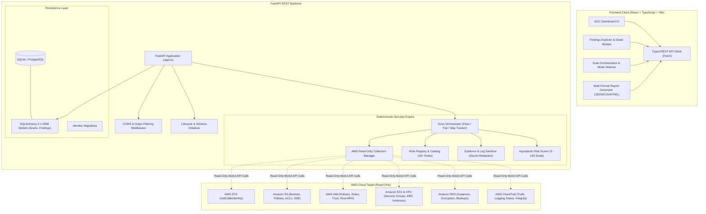

# CloudSentinel — System Architecture

CloudSentinel is an enterprise-grade cloud security and compliance auditing platform built with Python (FastAPI) and React (TypeScript + Vite + Tailwind CSS).

The platform operates on a fundamental principle: **read-only auditing by default, evidence-based findings, zero credential storage, and no automatic mutations of AWS resources.**

---

## 1. High-Level Architecture Diagram

---

## 2. Component Breakdown

### Frontend (React + TypeScript)
- **Vite Bundler**: Provides fast Hot Module Replacement during development and optimized static asset chunking for production.
- **Tailwind CSS**: Custom dark cybersecurity SOC styling with accessible contrast ratios and dynamic glowing status pills.
- **Typed API Client**: Handles REST communication with `/api/v1`, manages request error normalization, and supports report downloads.
- **Asynchronous Polling**: Tracks in-flight scans with automatic state synchronization.

### Backend (FastAPI + SQLAlchemy)
- **Asynchronous REST Handlers**: Stateless request handlers supporting background scan dispatching.
- **Deterministic Evaluation**: Rules are decoupled from AWS network communication, enabling 100% offline unit testability.
- **Sanitization Layer**: Recursively scans all evidence payloads and redacts secrets, keys, and tokens.
- **Formula Injection Prevention**: Prepends single quotes to dangerous spreadsheet formula characters (`=`, `+`, `-`, `@`) in CSV exports.

### AWS SDK Layer (Boto3)
- Strictly invokes read-only actions (`Describe*`, `Get*`, `List*`).
- Never requests write, mutate, delete, or create permissions.
- Bounded adaptive retry configuration with jitter for transient API throttling.
